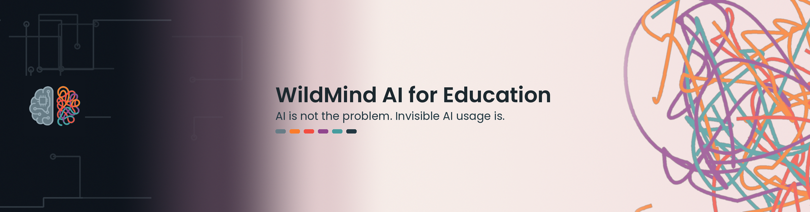
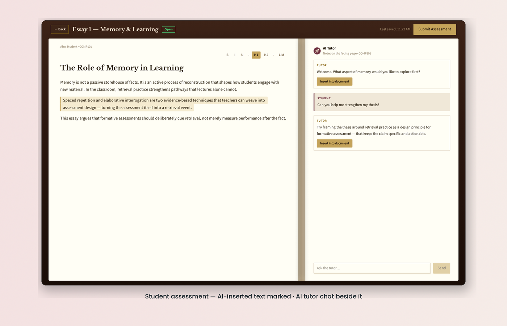
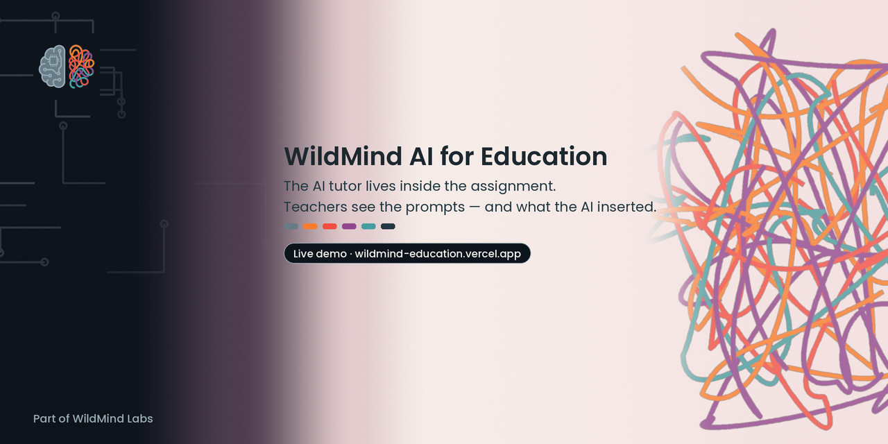

<p align="center">
  
</p>

<p align="center">
  <strong>WildMind AI for Education</strong><br>
  <em>AI isn’t the problem. Invisible AI usage is.</em><br>
  The AI tutor lives <strong>inside</strong> the assignment — so teachers can see the prompts and what the AI inserted.
</p>

<p align="center">
  <a href="https://wildmind-education.vercel.app"><strong>Live demo →</strong></a>
</p>

<p align="center">
  <a href="LICENSE"></a>
  <a href="https://wildmind-education.vercel.app"></a>
  
  
  
  
</p>

<p align="center">
  
</p>

<p align="center"><sub>Student view — AI-inserted text is marked in the document; the tutor chat sits beside the essay. (Framed capture from the bookshelf theme preview; core insert + chat behaviour ships on <code>main</code>.)</sub></p>

---

## What this is

A multi-role LMS prototype (student / teacher / admin) where writing assessments happen in a TipTap rich-text editor with an integrated AI tutor. When a student inserts AI text into the essay, that span is **visually marked** and recorded with the chat history on the attempt — so a teacher opening the attempt can see both the conversation and what landed in the document.

**Stack (as shipped):** React + Vite, TipTap, Prisma + Postgres (Neon-friendly), Vercel serverless API routes, Google Gemini via `/api/chat`.

---

## How it works

1. **Student** opens an assessment → TipTap editor + AI Tutor chat pane.
2. Student asks the tutor; can **Insert into document**. Inserted spans get an `aiInserted` mark (amber highlight) and an `InsertionEvent` in attempt state.
3. **Paste / drop into the editor is blocked** so external copy-paste doesn’t silently bypass tracking.
4. Attempt state (document JSON, `chatHistory`, `insertions`) **autosaves** to Postgres.
5. **Teacher** opens the student’s attempt **read-only** — same workspace, chat + marks visible — and can set a mark (0–100).
6. **Admin** gets a tenant overview (read-oriented today).

Auth for the demo is **mock email login** with unsigned base64 tokens (`api/lib/auth.ts`) — fine for a prototype, not production identity.

---

## Quickstart

**Prerequisites:** Node.js 18+, npm, a Postgres database.

```bash
git clone https://github.com/dlealvilla/wildmind-ai-for-education.git
cd wildmind-ai-for-education
npm install
cp .env.example .env
# Set DATABASE_URL, GEMINI_API_KEY, TOKEN_SECRET (see .env.example)
npm run db:push
npm run db:seed
npm run dev
```

Open the URL Vite prints (usually `http://localhost:5173`). Use the landing page role buttons, or `/login/student` and `/login/teacher`.

**Scripts:** `dev`, `build`, `lint`, `preview`, `db:generate`, `db:push`, `db:migrate`, `db:seed`, `db:studio`. There is **no** `npm test` yet — see [good first issues](docs/good-first-issues.md).

**Gemini:** Prefer `GEMINI_API_KEY` (server-only). Current `main` still accepts `VITE_GEMINI_API_KEY` as a fallback in `/api/chat` — don’t put a real key in a `VITE_` var.

---

## What’s missing (honest)

This is an open prototype, not a finished product.

| Gap | Notes |
| --- | --- |
| No automated tests | No `npm test`; paste-block / marks are manually demoed |
| No create-course API | Courses/assessments come from `prisma/seed.ts`; teacher API is mostly GET/PATCH |
| No per-assessment AI settings | Every open assessment gets the same tutor behaviour |
| Attempt analytics not on `main` | Sample analytics UI lives on theme/dev branches; scores aren’t computed from live attempts yet |
| Mock auth | Unsigned base64 tokens; `TOKEN_SECRET` not used to sign on current `main` |
| Gemini key hygiene | `/api/chat` still checks `VITE_GEMINI_*` and logs key metadata |
| Bookshelf theme | Open-book / shelf UI is on `theme/bookshelf` (open PR) — not merged to `main` |
| Demo page title | Historically “LMS Writing Prototype” in `index.html` (fixed on this launch branch) |

See [ROADMAP.md](ROADMAP.md) for the ordered view.

---

## Contributing

Please read [CONTRIBUTING.md](CONTRIBUTING.md).

Ready-to-paste starter tasks: **[docs/good-first-issues.md](docs/good-first-issues.md)**.

Also check GitHub labels [good first issue](https://github.com/dlealvilla/wildmind-ai-for-education/labels/good%20first%20issue) and [help wanted](https://github.com/dlealvilla/wildmind-ai-for-education/labels/help%20wanted).

---

## License

[MIT](LICENSE) © 2026 Daniel Leal Villaseca.

---

## Part of WildMind Labs

**WildMind Labs** — *Open source AI for human-machine collaboration.*

An open source lab solving AI problems in education and privacy, to maximise human-machine collaboration.

This repo is the education track: make AI use in student writing **visible** to teachers, not invisible.

<p align="center">
  
</p>
