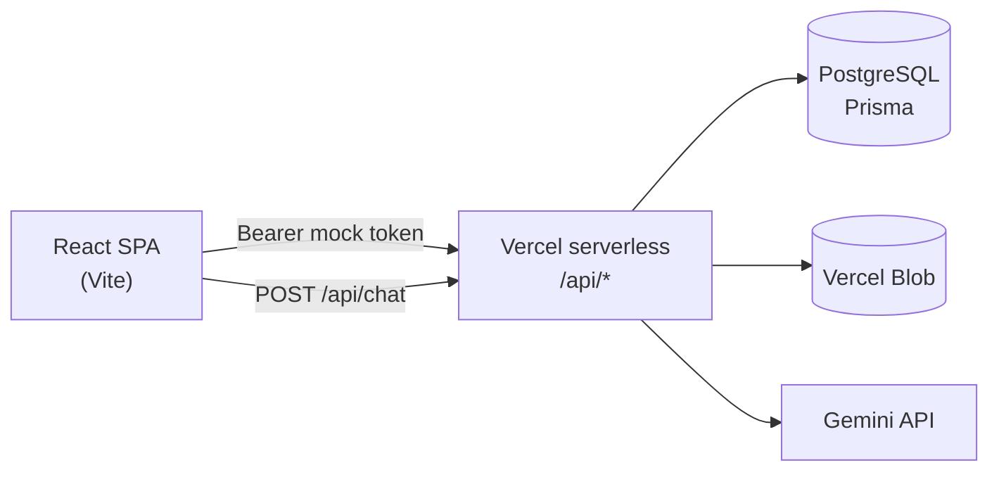
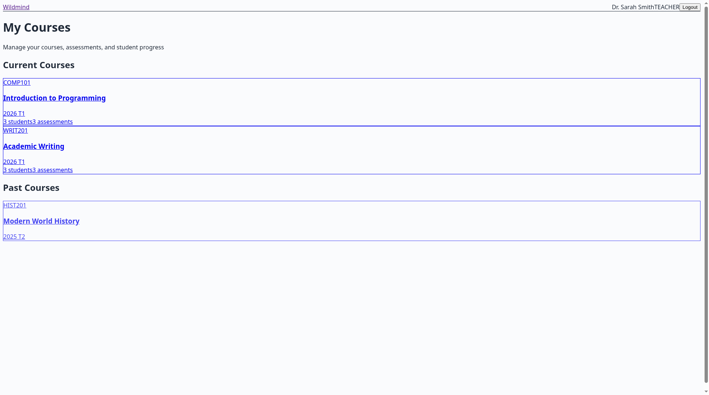
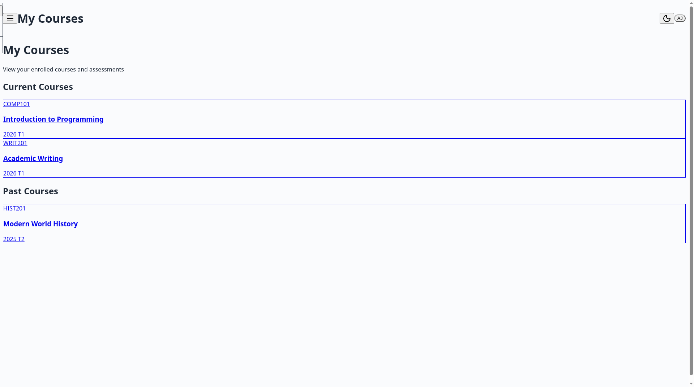
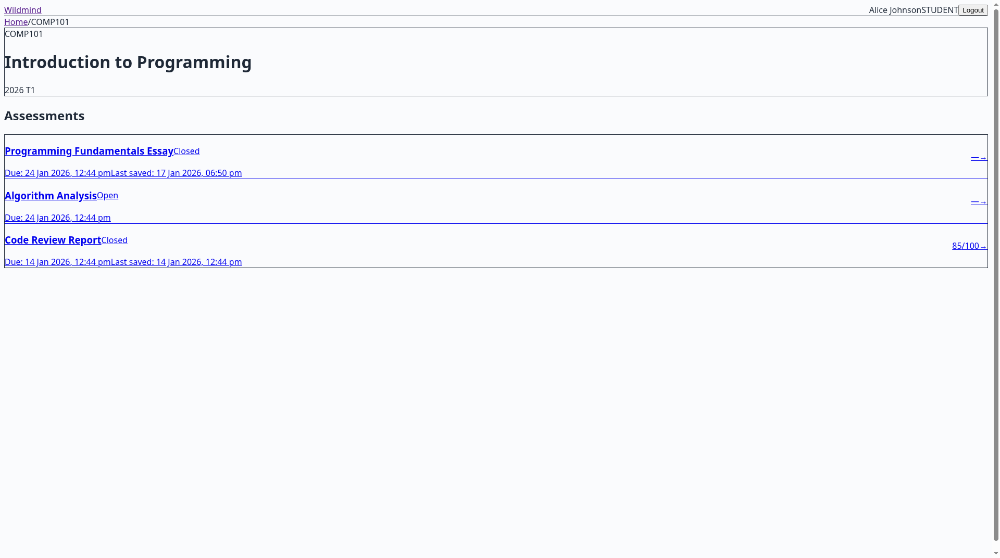
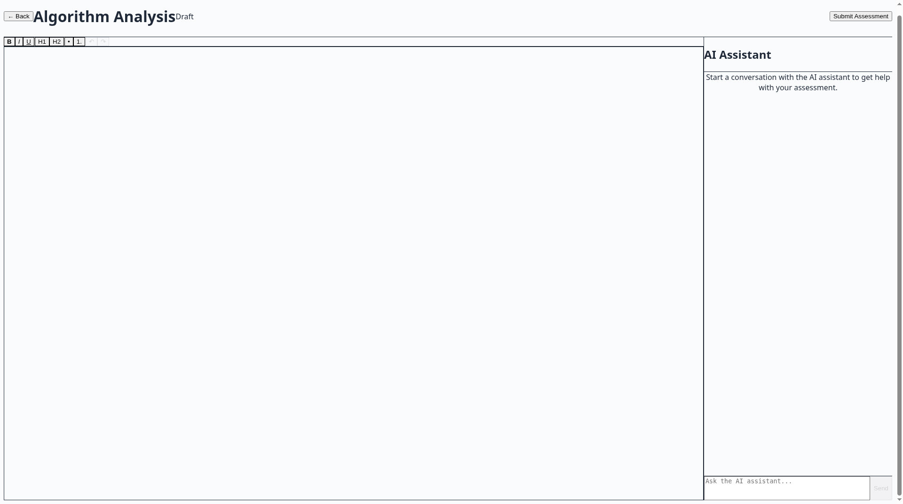
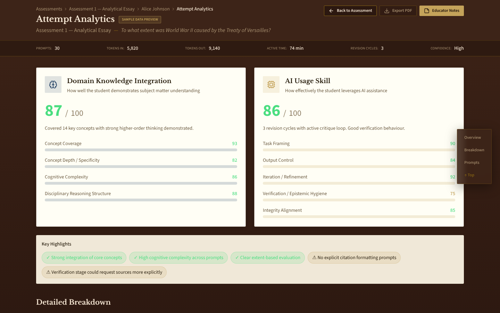

<p align="center"></p>

[](LICENSE)
[](https://www.typescriptlang.org/)
[](https://react.dev/)
[](https://www.prisma.io/)
[](https://ai.google.dev/)
[](https://vercel.com/)

# WildMind AI for Education

**Assignments. AI. Critical Thinking. Measured.**

AI is not the problem. Invisible AI usage is.

Students already use AI for assessments. When that happens in another tab, teachers see only the final text — no prompts, no revisions, no sense of whether the student challenged the model or copied it. Banning AI does not stop it; it pushes usage underground and removes visibility. Detection tools guess after the fact and often get it wrong.

WildMind brings AI inside the academic process so it becomes **observable, teachable, and evaluable**.

## The approach

Teacher → Student → Insight.

1. **No copy and paste.** The writing space blocks paste and drag-and-drop, so text cannot arrive from an outside AI tool.
2. **AI built into the writing.** Students get an assistant beside their work. They can ask questions and insert suggestions; every insertion is marked in the document.
3. **Tracked and controlled.** Prompts, replies, and inserted passages are saved with the attempt. Teachers see where AI helped and where the student did the work, and they decide when AI is allowed.
4. **AI use weighed against real knowledge.** Because usage is recorded rather than guessed, it can be compared with what the student shows they know — domain knowledge, effort, and AI literacy together.

That rewards both skills: learning the material, and learning to work well with AI.

## How it works today

- Students write in a rich-text editor with a Gemini-powered tutor beside it. Paste and drop are blocked; AI-inserted text is highlighted and logged.
- Each attempt saves the document, the full tutor chat, and every AI insertion (`AssessmentAttempt.state`).
- Teachers open and close assessments, attach a brief, review each attempt with its AI history, and mark it out of 100.
- An educator-only **Attempt Analytics** view shows Domain Knowledge Integration and AI Usage composites (with subscores) per attempt — currently a **preview on sample data**, clearly labelled in the UI. It is not yet computed from live attempts.
- Admins see users, courses, and overall stats for their school.

**Value in practice:** teachers get less suspicion and more guidance; students can use AI openly and build critical engagement instead of hiding it; institutions get a path toward evidence for AI policy rather than prohibition alone.

## Next on the roadmap

- Compute Domain Knowledge and AI Usage scores from real attempts (LLM-graded rubric over saved chat + insertions) — how questions are formulated, answers refined, and whether students challenge or accept AI outputs.
- Per-assessment AI settings (how much assistance is allowed).
- Vision further out: cohort learning patterns, structured institutional pilots, and clearer alignment with responsible-AI frameworks (for example Australia’s) — labelled as direction, not shipped product.

## Live demo

**https://wildmind-education.vercel.app** (Vercel project `wildmind-education`, production branch `main`)

Mock login — **any password** works. On the login screens, pick a demo user (or use the emails below):

| Role | Demo control | Email |
| --- | --- | --- |
| Teacher | **Dr. Smith** | `teacher@wildmind.edu` |
| Student | **Alice** | `alice@wildmind.edu` |
| Student | **Bob** | `bob@wildmind.edu` |
| Student | **Charlie** | `charlie@wildmind.edu` |

> A second Vercel project (`lms-ai` / lms-ai-sand.vercel.app) also builds from this repo and is being retired — prefer **wildmind-education**.

## Key features

- **Role-based portals** — Student, teacher, and admin experiences with route guards and mock login for demos
- **Multi-tenant data model** — Tenants, users, courses, enrollments, teachers, assessments, and attempts (Prisma / PostgreSQL)
- **Assessment workspace** — TipTap editor + AI chat; paste/drop blocked for integrity; AI-inserted text tracked; autosave of document, chat, and insertions
- **Teacher controls** — Course roster and assessments; open/close status with audit history; due dates and auto-close; PDF brief upload (Vercel Blob); attempt review and marks (0–100)
- **Admin dashboard** — Tenant user list, courses, and aggregate stats
- **Cron auto-close** — Due assessments can be closed automatically (`/api/cron/auto-close-assessments`)
- **Theme** — Bookshelf (wood / parchment) UI with open-book assessment workspace

## Tech stack

| Layer | Choices |
| --- | --- |
| Frontend | React 19, TypeScript, Vite 7, React Router 7, Tailwind CSS 4, shadcn/ui (Radix), Lucide |
| Editor / AI | TipTap, Google Generative AI (Gemini 2.5 Flash via `/api/chat`) |
| Backend | Vercel serverless functions (`api/`), mock Bearer tokens |
| Data | PostgreSQL, Prisma 6 |
| Storage | Vercel Blob (assessment PDFs) |
| Deploy | Vercel (`vercel.json` SPA + API rewrites) |

## Architecture



**Roles & main routes**

| Role | Routes |
| --- | --- |
| Public | `/`, `/login/:role` |
| Student | `/student/home`, `/student/courses/:courseId`, `.../assessments/:assessmentId` |
| Teacher | `/teacher/home`, `/teacher/courses/:courseId`, student + attempt mark views, attempt analytics (sample preview) |
| Admin | `/admin` |

**API surface (high level)** — `/api/auth/mock-login`, `/api/chat`, `/api/health` (DB ping / keep-warm), `/api/student/*`, `/api/teacher/*` (+ `pdf-upload`), `/api/admin/*`, `/api/cron/auto-close-assessments`.

## Getting started

### Prerequisites

- Node.js 20+ (recommended)
- A PostgreSQL database (local, Neon, or Vercel Postgres)
- Optional: Google AI (Gemini) API key; optional Vercel Blob token for PDF uploads

### Install

```bash
git clone https://github.com/dlealvilla/lms_ai.git
cd lms_ai
npm install
cp .env.example .env
# edit .env — at minimum set DATABASE_URL
```

### Database

```bash
npm run db:generate   # prisma generate
npm run db:push       # push schema (or use db:migrate)
npm run db:seed       # demo tenant "wildmind-academy" + sample users/courses
```

Seed demo emails (password ignored by mock login): `alice@wildmind.edu` / `bob@wildmind.edu` / `charlie@wildmind.edu` (students), `teacher@wildmind.edu`, `admin@wildmind.edu`.

### Run locally

```bash
npm run dev
```

Open the Vite URL (typically `http://localhost:5173` or the port Vite prints). For full API behaviour matching production, deploy to Vercel or run the serverless handlers with the Vercel CLI (`vercel dev`) so `/api/*` is available.

### Useful scripts

| Script | Purpose |
| --- | --- |
| `npm run dev` | Vite frontend |
| `npm run build` | Typecheck + production build |
| `npm run db:studio` | Prisma Studio |
| `npm run lint` | ESLint |

## Environment variables

Names and purpose only — never commit real values. See `.env.example`.

| Variable | Purpose |
| --- | --- |
| `DATABASE_URL` | PostgreSQL connection string for Prisma (prefer Neon **pooled** URL; `connect_timeout` is added automatically if missing) |
| `GEMINI_API_KEY` | **Server-only** Gemini key for `/api/chat`. Never use a `VITE_` prefix — that would embed the key in the browser bundle |
| `TOKEN_SECRET` | Required in production (app refuses a weak default). Mock auth tokens are still unsigned base64 today |
| `CRON_SECRET` | Shared secret for `x-cron-secret` on the auto-close cron route |
| `BLOB_READ_WRITE_TOKEN` | Vercel Blob read/write token for assessment PDF upload |
| `NODE_ENV` | Runtime mode (`development` / `production`) |

## Project structure

```
api/                     # Vercel serverless handlers
  auth/mock-login.ts
  chat.ts
  health.ts              # DB ping / keep-warm
  student|teacher|admin/ # role APIs (catch-all [[...path]])
  teacher/pdf-upload.ts
  cron/auto-close-assessments.ts
  lib/auth.ts, lib/db.ts
prisma/
  schema.prisma          # tenants, users, courses, assessments, attempts, …
  seed.ts
src/
  pages/                 # Landing, Login, student|teacher|admin
  components/            # AssessmentWorkspace, Editor, Chat, Layout, ui
  lib/ai, lib/auth, lib/theme, lib/storage
  types/assessment.ts
vercel.json
```

## Screenshots

Local captures against the Bookshelf theme (1440×900, route-mocked API).

| View | Screenshot |
| --- | --- |
| Teacher dashboard |  |
| Student home |  |
| Course with assessments |  |
| Assessment editor with AI panel |  |
| Teacher attempt analytics (sample preview) |  |

## Team

Built by Daniel Leal Villaseca. Thanks to Cristóbal Olave Tessada, who co-founded WildMind AI for Education with Daniel and contributed on the business side, including the early pitch and go-to-market thinking.

## License

TODO: choose a licence (none selected yet).
