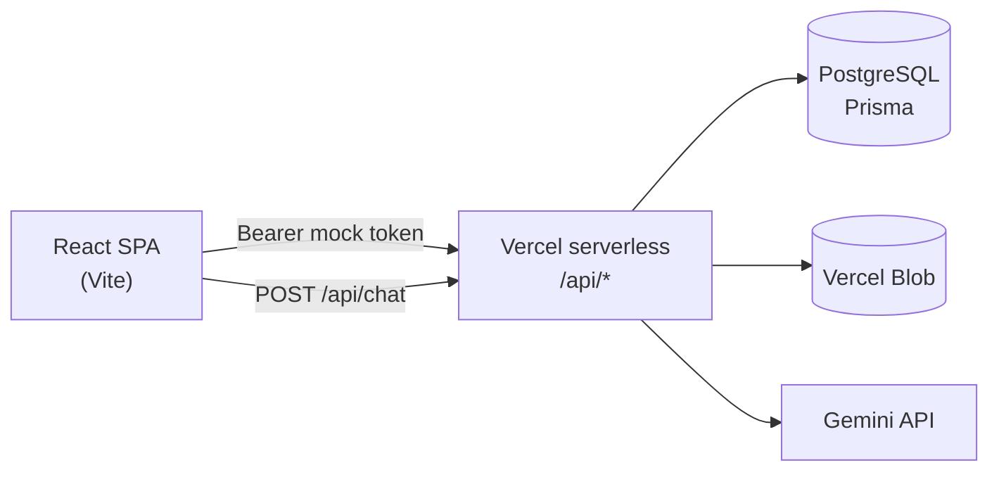

# Wildmind Education — AI LMS

**Let students use AI for their assessments, in the open, where teachers can see it.**

## The problem

Students already use AI for their assessments and homework. They do it in another tab and paste the result in, and nobody can see it. Teachers can't tell what the student wrote and what the AI wrote. Detection tools guess and often get it wrong. Banning AI doesn't work and doesn't prepare students for a world where AI is everywhere.

## The approach

Wildmind brings the AI inside the assignment instead of fighting it from outside.

1. **No copy and paste.** The writing space blocks paste and drag-and-drop, so text can't arrive from an outside AI tool.
2. **AI built into the writing.** Students get an AI assistant right next to their work. They can ask it questions and insert its suggestions, and every insertion is marked in the document.
3. **Tracked and controlled.** Each prompt, reply and inserted passage is saved with the attempt. Teachers see exactly where AI helped and where the student did the work, and they decide when and how much AI is allowed.
4. **AI use compared with real knowledge.** Because AI use is recorded rather than guessed, it can be weighed against what the student shows they know. That rewards both skills: learning the material, and learning to work well with AI.

## How it works today

- Students write in a rich-text editor with a Gemini-powered assistant beside it. Paste and drop are blocked, and AI-inserted text is highlighted and logged.
- Each attempt saves the document, the full AI chat and every AI insertion.
- Teachers open and close assessments, attach a brief, review each attempt with its AI history, and mark it out of 100.
- Admins see the users, courses and overall stats for their school.

**Next on the roadmap:** per-student analytics that compare AI reliance with demonstrated knowledge, plus AI-use settings for each assessment.

## Live demo

**https://wildmind-education.vercel.app** (Vercel project `wildmind-education`, production branch `main`)

Mock login — **any password** works. On the login screens, pick a demo user (or use the emails below):

| Role | Demo control | Email |
| --- | --- | --- |
| Teacher | **Dr. Smith** | `teacher@wildmind.edu` |
| Student | **Alice** | `alice@wildmind.edu` |
| Student | **Bob** | `bob@wildmind.edu` |
| Student | **Charlie** | `charlie@wildmind.edu` |

> A second Vercel project (`lms-ai` / lms-ai-sand.vercel.app) also builds from this repo and is being retired — prefer **wildmind-education**.

## Key features

- **Role-based portals** — Student, teacher, and admin experiences with route guards and mock login for demos
- **Multi-tenant data model** — Tenants, users, courses, enrollments, teachers, assessments, and attempts (Prisma / PostgreSQL)
- **Assessment workspace** — TipTap editor + AI chat; paste/drop blocked for integrity; AI-inserted text tracked; autosave of document, chat, and insertions
- **Teacher controls** — Course roster and assessments; open/close status with audit history; due dates and auto-close; PDF brief upload (Vercel Blob); attempt review and marks (0–100)
- **Admin dashboard** — Tenant user list, courses, and aggregate stats
- **Cron auto-close** — Due assessments can be closed automatically (`/api/cron/auto-close-assessments`)
- **Theme** — Day/night UI via app shell

## Tech stack

| Layer | Choices |
| --- | --- |
| Frontend | React 19, TypeScript, Vite 7, React Router 7, Tailwind CSS 4, shadcn/ui (Radix), Lucide |
| Editor / AI | TipTap, Google Generative AI (Gemini 2.5 Flash via `/api/chat`) |
| Backend | Vercel serverless functions (`api/`), mock Bearer tokens |
| Data | PostgreSQL, Prisma 6 |
| Storage | Vercel Blob (assessment PDFs) |
| Deploy | Vercel (`vercel.json` SPA + API rewrites) |

## Architecture



**Roles & main routes**

| Role | Routes |
| --- | --- |
| Public | `/`, `/login/:role` |
| Student | `/student/home`, `/student/courses/:courseId`, `.../assessments/:assessmentId` |
| Teacher | `/teacher/home`, `/teacher/courses/:courseId`, student + attempt mark views |
| Admin | `/admin` |

**API surface (high level)** — `/api/auth/mock-login`, `/api/chat`, `/api/health` (DB ping / keep-warm), `/api/student/*`, `/api/teacher/*` (+ `pdf-upload`), `/api/admin/*`, `/api/cron/auto-close-assessments`.

## Getting started

### Prerequisites

- Node.js 20+ (recommended)
- A PostgreSQL database (local, Neon, or Vercel Postgres)
- Optional: Google AI (Gemini) API key; optional Vercel Blob token for PDF uploads

### Install

```bash
git clone https://github.com/dlealvilla/lms_ai.git
cd lms_ai
npm install
cp .env.example .env
# edit .env — at minimum set DATABASE_URL
```

### Database

```bash
npm run db:generate   # prisma generate
npm run db:push       # push schema (or use db:migrate)
npm run db:seed       # demo tenant "wildmind-academy" + sample users/courses
```

Seed demo emails (password ignored by mock login): `alice@wildmind.edu` / `bob@wildmind.edu` / `charlie@wildmind.edu` (students), `teacher@wildmind.edu`, `admin@wildmind.edu`.

### Run locally

```bash
npm run dev
```

Open the Vite URL (typically `http://localhost:5173` or the port Vite prints). For full API behaviour matching production, deploy to Vercel or run the serverless handlers with the Vercel CLI (`vercel dev`) so `/api/*` is available.

### Useful scripts

| Script | Purpose |
| --- | --- |
| `npm run dev` | Vite frontend |
| `npm run build` | Typecheck + production build |
| `npm run db:studio` | Prisma Studio |
| `npm run lint` | ESLint |

## Environment variables

Names and purpose only — never commit real values. See `.env.example`.

| Variable | Purpose |
| --- | --- |
| `DATABASE_URL` | PostgreSQL connection string for Prisma (prefer Neon **pooled** URL; `connect_timeout` is added automatically if missing) |
| `GEMINI_API_KEY` | **Server-only** Gemini key for `/api/chat`. Never use a `VITE_` prefix — that would embed the key in the browser bundle |
| `TOKEN_SECRET` | Required in production (app refuses a weak default). Mock auth tokens are still unsigned base64 today |
| `CRON_SECRET` | Shared secret for `x-cron-secret` on the auto-close cron route |
| `BLOB_READ_WRITE_TOKEN` | Vercel Blob read/write token for assessment PDF upload |
| `NODE_ENV` | Runtime mode (`development` / `production`) |

## Project structure

```
api/                     # Vercel serverless handlers
  auth/mock-login.ts
  chat.ts
  health.ts              # DB ping / keep-warm
  student|teacher|admin/ # role APIs (catch-all [[...path]])
  teacher/pdf-upload.ts
  cron/auto-close-assessments.ts
  lib/auth.ts, lib/db.ts
prisma/
  schema.prisma          # tenants, users, courses, assessments, attempts, …
  seed.ts
src/
  pages/                 # Landing, Login, student|teacher|admin
  components/            # AssessmentWorkspace, Editor, Chat, Layout, ui
  lib/ai, lib/auth, lib/theme, lib/storage
  types/assessment.ts
vercel.json
```

## Screenshots

| View | Screenshot |
| --- | --- |
| Teacher dashboard |  |
| Student home |  |
| Course with assessments |  |
| Assessment editor with AI panel |  |

## License

[MIT](LICENSE)
